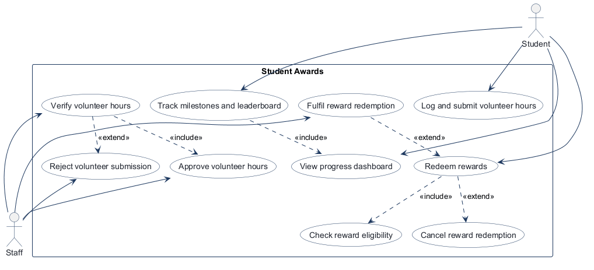
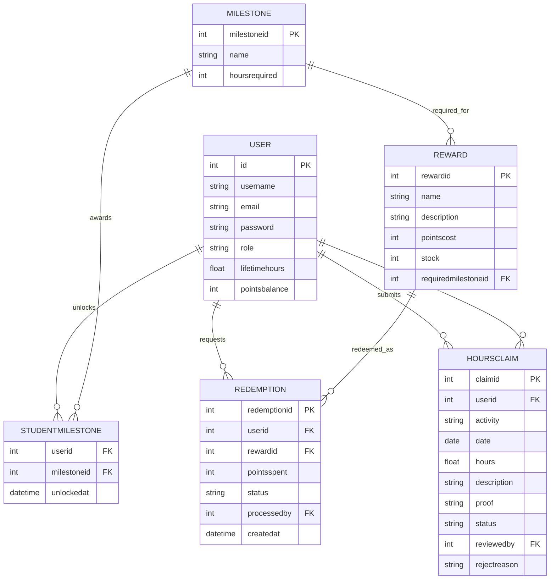

# COMP 3613 Assignment 2

## Name & ID
Student Awards Project  
Student ID: not provided in the repo; insert before submission

## Project Description
This project is a student volunteer and rewards system. It supports volunteer-hours claims, staff review and approval, progress tracking with milestones and leaderboard ranking, and reward redemption with staff fulfilment/cancellation.

## Use Case Diagram



## Entity Relationship Diagram



## Application Wireframe

### Workflow 1: volunteer hours
- [Submit hours](../wireframes/w1-1-submit-hours-student.png)
- [My claims](../wireframes/w1-2-my-claims-student.png)
- [Review queue](../wireframes/w1-3-review-queue-staff.png)
- [Approve or reject](../wireframes/w1-4-approve-or-reject-staff.png)

### Workflow 2: progress and leaderboard
- [Progress dashboard](../wireframes/w2-1-progress-dashboard-student.png)
- [Milestone unlock](../wireframes/w2-2-milestone-unlocked-student.png)
- [Leaderboard](../wireframes/w2-3-leaderboard-student.png)

### Workflow 3: rewards and redemptions
- [Reward catalog](../wireframes/w3-1-reward-catalog-student.png)
- [Eligibility check](../wireframes/w3-2-redeem-eligibility-check-student.png)
- [My redemptions](../wireframes/w3-3-my-redemptions-student.png)
- [Fulfil or cancel](../wireframes/w3-4-fulfil-or-cancel-staff.png)

## Test Plans

See [docs/assignment2/test-plans.md](test-plans.md).

## Unit Tests
- File: [tests/test_hours_flow.py](../../tests/test_hours_flow.py)
- Coverage includes service logic, validation, and approval/rejection behaviour.
- Run command:

```bash
python -m pytest tests/test_hours_flow.py -q
```

## Integration Tests
- File: [tests/test_hours_flow.py](../../tests/test_hours_flow.py)
- Uses FastAPI `TestClient` to validate login, claim creation, progress, and rewards routes.

## Implementation
- JSON API endpoints are implemented in [app/routers/users.py](../../app/routers/users.py)
- Auth logic is in [app/dependencies/auth.py](../../app/dependencies/auth.py)
- Behavior is routed through the service layer in [app/services/hours_service.py](../../app/services/hours_service.py)
- Reused database models remain unchanged to avoid breaking the live schema.

## Repository Link
https://github.com/uwidcit/comp3613a1

## API Tests (Postman collection)
- Collection file: [docs/assignment2/postman/StudentAwards_API_Assignment2.postman_collection.json](postman/StudentAwards_API_Assignment2.postman_collection.json)
- Import into Postman and run against `http://127.0.0.1:5000`

## Reports
- Unit test output report: [docs/assignment2/reports/unit-tests.txt](reports/unit-tests.txt)
- Integration test output report: [docs/assignment2/reports/integration-tests.txt](reports/integration-tests.txt)
- Postman run summary: [docs/assignment2/reports/postman-run.txt](reports/postman-run.txt)

## Summary
The application satisfies the assignment requirements by providing: student and staff claim workflows, milestone and leaderboard tracking, reward eligibility and redemption flow, and protected JSON API routes with role-based authorization.
