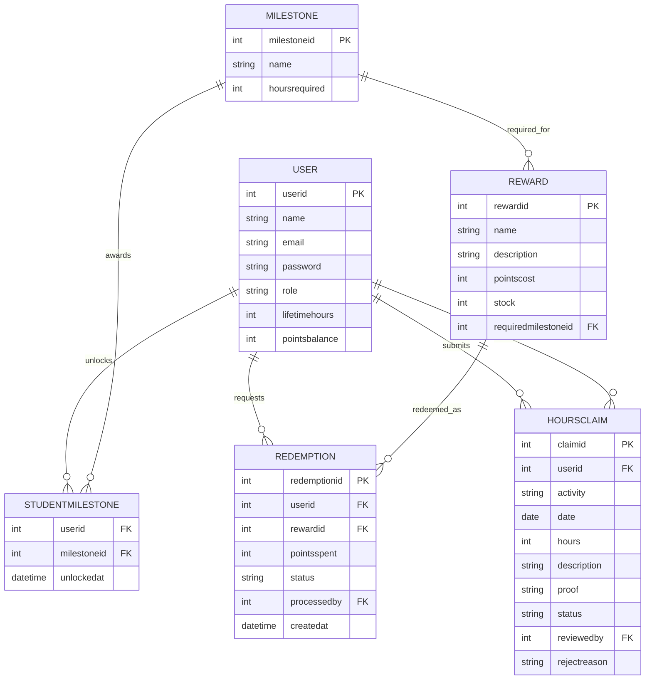

# COMP 3613 Assignment 1

Draft this file with the Guide. **Update it after every phase milestone** before you pause. The use-case diagram is a UML PNG at `docs/diagrams/use-case.png`, linked from this file as `diagrams/use-case.png` (path relative to `docs/report.md`). The model diagram is Mermaid. **Embed wireframe images** as `wireframes/<file>` (files live in `docs/wireframes/`).

Do not put your student ID in this file if you will commit it. The PDF cover adds your name and ID at export time.

## Assigned project

Student Awards

## Three workflows

### 1. Track milestones and leaderboard (Student)

### 2. Redeem rewards (Student)

### 3. Log and verify volunteer hours (Staff)

## Use case diagram

Assumed: progress dashboard is a standalone student view; reward eligibility is included in reward redemption; students log and submit volunteer hours; staff verification is the main staff use case, with approve/reject as linked outcomes; reward fulfilment is a staff-side extension of redemption; cancel redemption remains an extension of redeem; extend arrows point to the base use case.

## Model diagram

First draft. Update this section in Phase 5 when polish revises the model, and note what changed.

Relationship and edge-case assumptions: a student submits many hours claims; each claim can include optional proof (supervisor name/contact or a link) and is reviewed by a staff user; approved claims contribute to lifetimehours and milestone unlock checks; a student can unlock many milestone records; a reward may require a milestone before it can be redeemed; each redemption belongs to one user and one reward; cancellation restores points and stock; only approved claims count toward leaderboard totals and milestone progression.

## Wireframes

### Workflow 1 — Log and verify volunteer hours

.drawio.png)

.drawio.png)

.drawio.png)

.drawio.png)

### Workflow 2 — Track milestones and leaderboard

.drawio.png)

.drawio.png)

.drawio.png)

### Workflow 3 — Redeem rewards

.drawio.png)

.drawio.png)

.drawio.png)

.drawio.png)

Phase 4 coverage note: each named workflow has a complete wireframe set, and the student flow, staff verification flow, and reward redemption flow are all represented in the attached images.

## Theming

Branding preference selected: purple/indigo with a modern, premium student-awards feel. The landing, login, and register pages are styled using a purple-indigo palette and consistent card-based layout to fit the project identity.

## Implementation notes

Workflow 1: Log and verify volunteer hours.

- Implemented a student claim form and claim history on the user dashboard.
- Added a staff review queue where admin users can approve or reject claims.
- Added the hours claim model, claim repository, and service logic to persist submissions and to update lifetime hours and milestone unlocks when approved.
- Verified with the project test suite: `python -m pytest tests/test_hours_flow.py -q` passed (`2 passed`).
- This workflow is the foundation for the other two flows, since milestone and reward progress depend on approved volunteer hours.

## Deployed app

Phase 6. Render is configured in the repo and ready to deploy, but this session does not currently have the authenticated Render MCP/API key needed to create the live Postgres + web service from here.

Public Render URL (not localhost): pending deployment after Render authentication is completed.

## Logins

Every account a marker needs, including the seeded demo users for leaderboard and milestone testing:

- bob / bobpass — regular user (53h)
- sasha / sashapass — regular user (62h)
- milo / milopass — regular user (48h)
- nina / ninapass — regular user (30h)
- omar / omarpass — regular user (19h)
- priya / priyapass — regular user (8h)
- admin / adminpass — admin

## YouTube URL

## Session transcripts

Filled when the Guide builds the report: the agent writes each Guide chat to `docs/transcripts/<slug>.md` (Copilot Agent, Cursor, or OpenCode). `python manage.py report` packages them. Do not paste chats here during the build.

## Competency (student-judge)

Filled when the report is built. Guide runs student-judge, writes `docs/judge.md`, and export appends the scorecard here.

## Skill integrity

Filled by `python manage.py report`. Do not edit the course skills.
