<!-- student-build:skill-integrity
status: pass
root: e84cd692d0b85eefe546385661958c27d07e8be6c5176a82012f68ccff5c8beb
expected_root: e84cd692d0b85eefe546385661958c27d07e8be6c5176a82012f68ccff5c8beb
mismatches: none
-->

# COMP 3613 Assignment 1

Draft this file with the Guide. **Update it after every phase milestone** before you pause. The use-case diagram is a UML PNG at `docs/diagrams/use-case.png`, linked from this file as `diagrams/use-case.png` (path relative to `docs/report.md`). The model diagram is Mermaid. **Embed wireframe images** as `wireframes/<file>` (files live in `docs/wireframes/`).

Do not put your student ID in this file if you will commit it. The PDF cover adds your name and ID at export time.

## Assigned project

Student Awards

## Three workflows

### 1. Log and verify volunteer hours (Student, Staff)

Who acts: Student logs the claim; staff reviews and approves or rejects it.

1. Student enters the activity, date, hours, description, and optional proof for a volunteer session.
2. The system stores a pending claim and shows it in the student claim history.
3. Staff opens the review queue and checks the claim details and any uploaded proof.
4. Staff approves the claim to add approved hours to the student lifetime total and award points, or rejects it with a reason.
5. The student sees the updated status and total in their hours view.

Done when: the claim is either approved or rejected with a reason, the points and lifetime-hours totals are correct, and the student can see the final state in their dashboard.

### 2. Track milestones and leaderboard (Student)

Who acts: Student views progress and milestone unlocks.

1. Each approved claim adds to the student lifetime hours total.
2. The system compares lifetime hours to milestone thresholds (Bronze, Silver, Gold).
3. The student can see the current milestone, next milestone, and leaderboard ranking.
4. The leaderboard is sorted by total lifetime hours, excluding admins.

Done when: the student can clearly see their current milestone, next target, and rank relative to other students, and milestone unlocks appear only after crossing the threshold.

### 3. Redeem rewards (Student, Staff)

Who acts: Student requests rewards; staff fulfils or cancels them.

1. Student views the reward catalog, checks eligibility, and opens the redeem confirmation step.
2. The system validates stock, points balance, milestone requirement, and any redemption block conditions.
3. Student confirms the request and the reward moves into a requested state with points deducted and stock reduced.
4. Staff reviews the redemption queue and either fulfils or cancels it.
5. If cancelled, points and stock are restored; if fulfilled, the request is closed as complete.

Done when: the reward request is tracked properly, stock remains consistent, points are adjusted correctly, and the staff queue can complete or cancel the request without breaking student totals.

## Interpretation

- Actors: Student, Staff, and the app system.
- Assumptions: lifetime hours represent approved volunteer time for progress and leaderboard calculations; points balance is separate from lifetime hours and is used as the reward currency; a claim is only counted once it is approved.
- Business rules: approval adds 10 points per approved hour; a student must unlock the required milestone to redeem milestone-gated rewards; a rejected claim must include a rejection reason.
- Edge cases: the app enforces a 24-hour per-day submission cap for the claim form; a reward cannot be redeemed if stock is zero; staff cancellation restores both points and stock; proof is optional but should be retained when provided.
- MVP scope: the app covers claim logging, admin review, milestone tracking, leaderboard rankings, reward catalog, redemption flow, and staff fulfilment/cancellation. It does not include complex inventory management beyond the current reward stock checks.

## Use case diagram

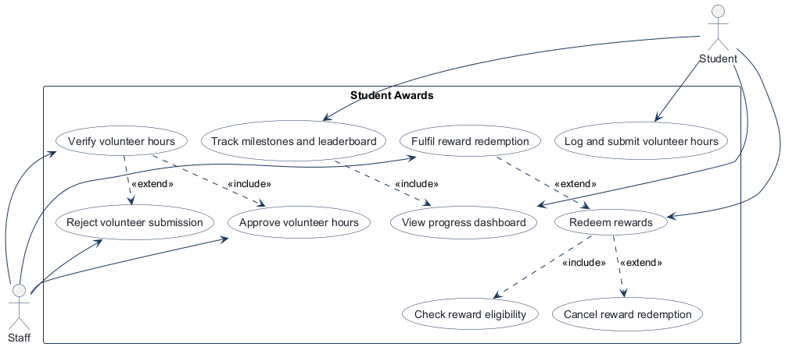

Assumed: progress dashboard is a standalone student view; reward eligibility is included in reward redemption; students log and submit volunteer hours; staff verification is the main staff use case, with approve/reject as linked outcomes; reward fulfilment is a staff-side extension of redemption; cancel redemption remains an extension of redeem; extend arrows point to the base use case.

## Model diagram

What changed: added an optional proof field to HoursClaim so volunteers can attach supporting evidence; kept pointsbalance separate from lifetimehours so progress and reward currency are tracked independently; and created StudentMilestone records when an approval pushes a student past a milestone threshold, enabling accurate unlock checks and leaderboard status.

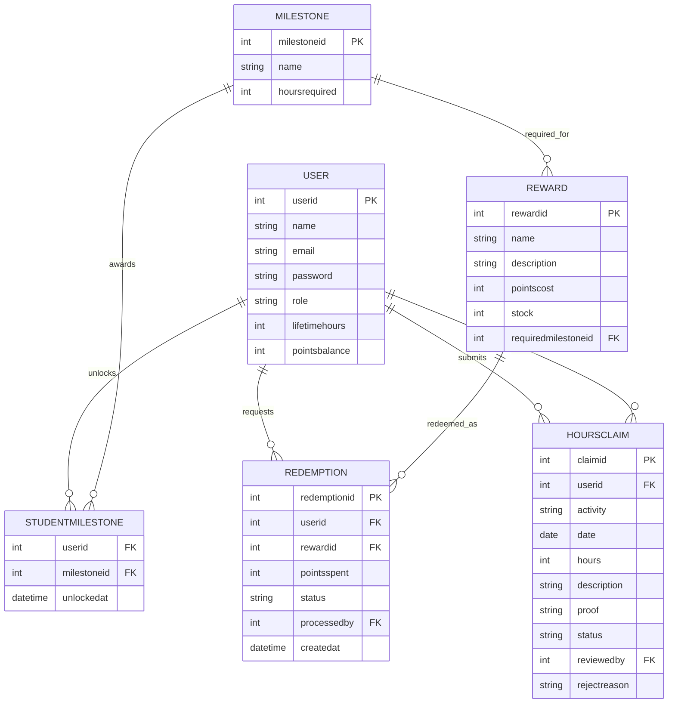

Relationship and edge-case assumptions: a student submits many hours claims; each claim can include optional proof (supervisor name/contact or a link) and is reviewed by a staff user; approved claims contribute to lifetimehours and milestone unlock checks; a student can unlock many milestone records; a reward may require a milestone before it can be redeemed; each redemption belongs to one user and one reward; cancellation restores points and stock; only approved claims count toward leaderboard totals and milestone progression.

## Wireframes

### w1 1 submit hours student

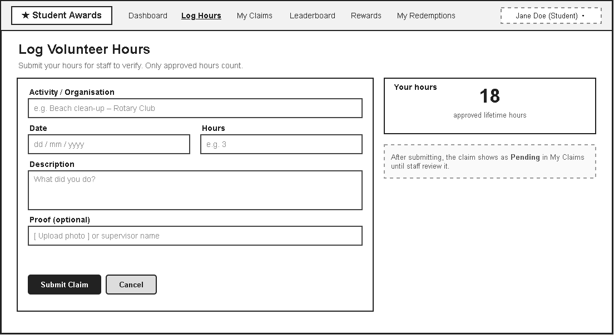

### w1 2 my claims student

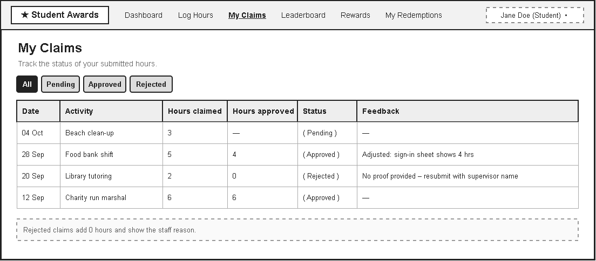

### w1 3 review queue staff

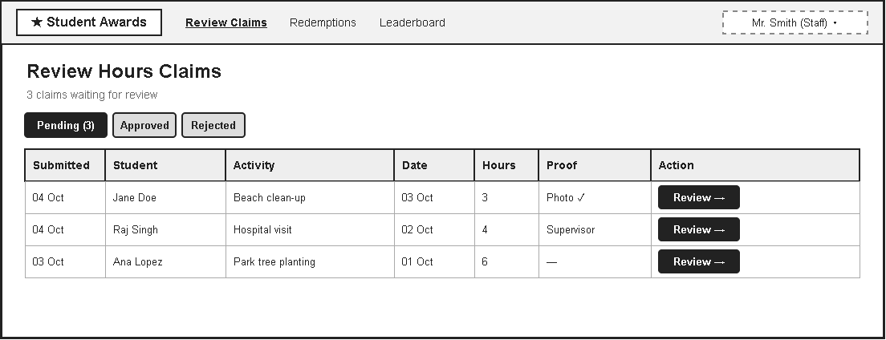

### w1 4 approve or reject staff

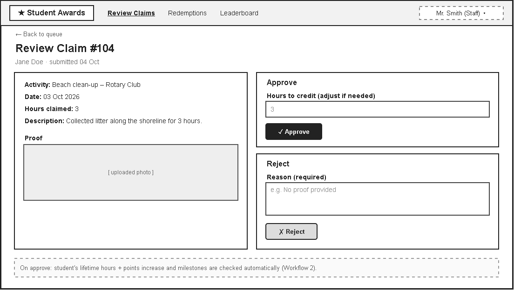

### w2 1 progress dashboard student

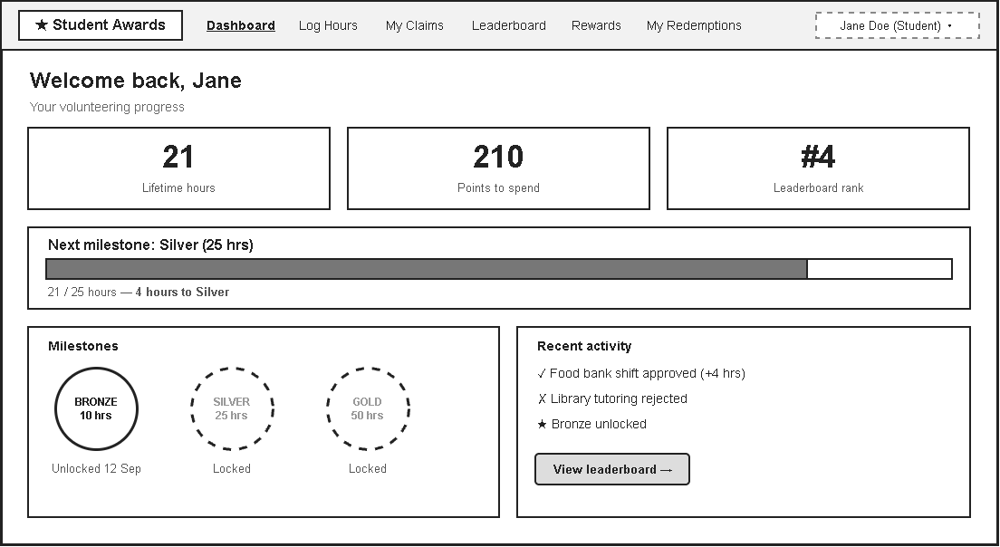

### w2 2 milestone unlocked student

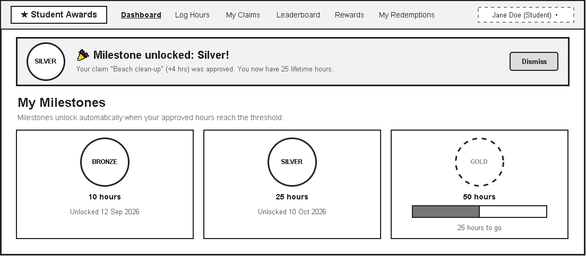

### w2 3 leaderboard student

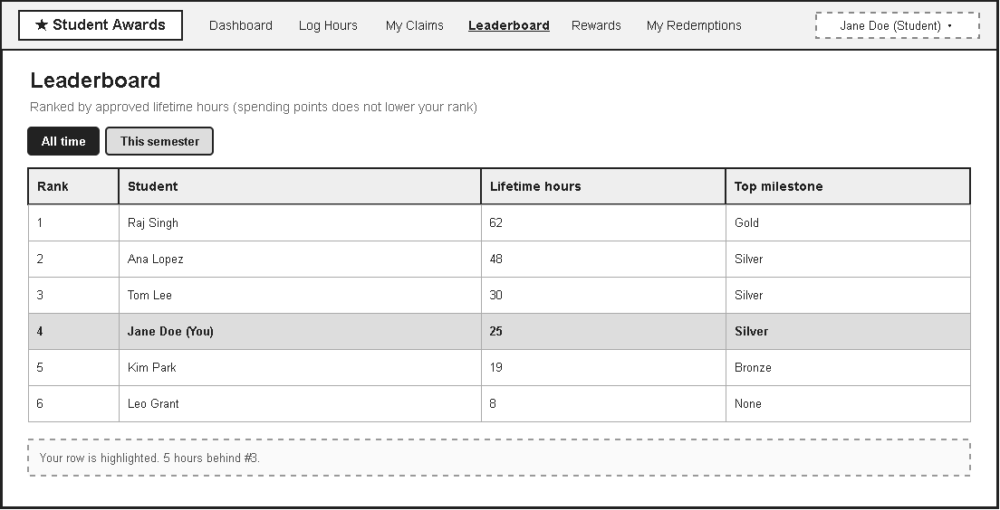

### w3 1 reward catalog student

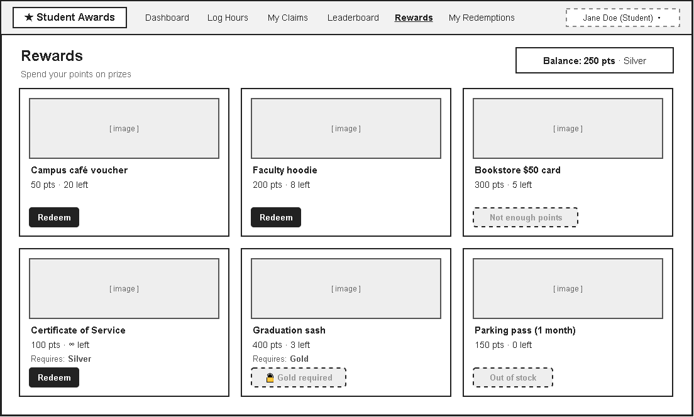

### w3 2 redeem eligibility check student

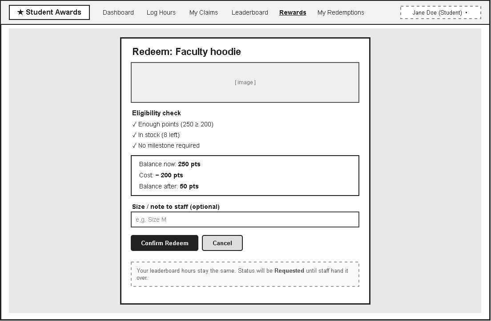

### w3 3 my redemptions student

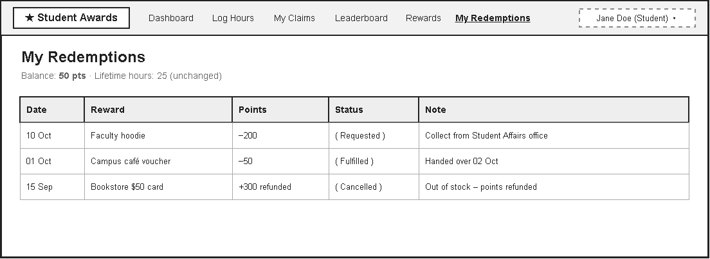

### w3 4 fulfil or cancel staff

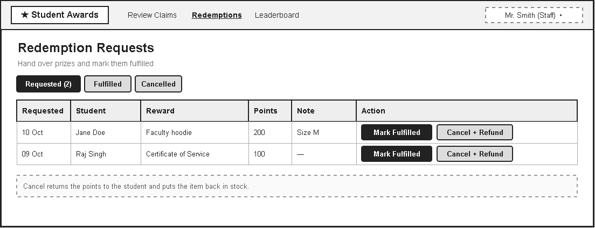
## Theming

Branding preference selected: purple/indigo with a modern, premium student-awards feel. The landing, login, and register pages are styled using a purple-indigo palette and consistent card-based layout to fit the project identity.

## Implementation notes

Workflow 1: Log and verify volunteer hours.

- Implemented the student claim form and claim history so a student can submit volunteer work with optional proof.
- Added the staff review queue for approvals and rejections, including a mandatory reject reason when a claim is rejected.
- Added logic to enforce the 24-hour cap and ensure approved claims increase lifetime hours and points properly.
- Fixed the bug where claims were not showing correctly after submission by keeping the state and dashboard flow aligned with the student and staff views.

Workflow 2: Track milestones and leaderboard.

- Added milestone thresholds for Bronze, Silver, and Gold and created StudentMilestone rows when a student crosses the threshold.
- Fixed the admin landing-page bug so staff users do not land on the student dashboard when accessing the app.
- Kept lifetime hours and points separate so ranking reflects the real approved-time progress while rewards use a separate balance.
- Polished the student progress view to make the current milestone, next milestone, and leaderboard status obvious.

Workflow 3: Redeem rewards.

- Added a confirmation-step reward redemption flow to match the wireframe and avoid immediate redeeming.
- Fixed the Gold reward lock issue so gold-level students can redeem the Gold Access Pass when eligible.
- Fixed the seeded points bug so defaults stay correct when the app is initialized.
- Fixed stock decrementing to make reward stock decrease on a successful request while canceling restores the count.
- Added the missing proof field to HoursClaim and kept it available in the data model and submission flow.
- Added reward fulfilment/cancellation handling for staff so stock and points remain consistent under both outcomes.

Polish and verification.

- Refined the student dashboard, reward catalog, staff review actions, and confirmation screens so the UI matches the workflow design.
- Kept the app aligned with the architecture: thin routes call service logic, and business rules remain in services instead of route handlers.
- Verified the app with the real project suite: `python -m pytest tests/test_hours_flow.py -q` passed with 16 tests passing.
- Project repo: https://github.com/Zydem/comp3613a1
- Agent used: GitHub Copilot (MAI-Code-1.1-Flash)

## Deployed app

Phase 6. The Render app is live and responding on the public URL below.

Public Render URL (not localhost): https://faststarter-961m.onrender.com

## Logins

Every account a marker needs, including the seeded demo users for leaderboard and milestone testing:

- bob / bobpass — regular user (53h)
- sasha / sashapass — regular user (62h)
- milo / milopass — regular user (48h)
- nina / ninapass — regular user (30h)
- omar / omarpass — regular user (19h)
- priya / priyapass — regular user (8h)
- admin / adminpass — admin

## YouTube URL

https://youtu.be/eGBhhZdR0io

## Session transcripts

Filled when the Guide builds the report: the agent writes chat markdown into `docs/transcripts/`; `python manage.py report` packages them.

Guide packaged **3** chat(s) in `docs/transcripts/` (and `docs/transcripts.zip`).

Index: [docs/transcripts/INDEX.md](transcripts/INDEX.md)

- [`phase-1-2-guide`](transcripts/phase-1-2-guide.md)
- [`phase-3-4-guide`](transcripts/phase-3-4-guide.md)
- [`phase-5-6-guide`](transcripts/phase-5-6-guide.md)

## Competency (student-judge)

Filled by Guide from the student-judge run when this report was built.

**Student / session:** FastStarter Student
**Artifact:** Guide chat summaries and current project report evidence for the Student Awards build
**Phases in evidence:** 1–6 (COMP 3613; Phase 5 polish, Phase 6 deploy; never generic 0–5)

**Judged at:** 2026-10-12T00:00:00Z
**Evidence pass:** re-read current report, design artefacts, and Guide summary transcripts; prior judge content ignored

## Summary

This build shows strong engagement across the full COMP 3613 flow. The student clearly framed the project, owned the workflows and model decisions, produced a complete wireframe set, verified the app in practice, and completed the required deployment step. The project also kept the implementation aligned to the layer structure and the assignment-specific requirements for claim approval, milestones, rewards, and staff review.

## Rubric scores

| ID | Metric | Score | Notes |
| --- | --- | ---: | --- |
| M1 | Phase discipline | 4 | Design was phased and the app was not shipped before the wireframe/model work was in place; Phase 5 polish preceded the deployment phase. |
| M2 | Problem framing | 4 | Student named the three workflows and kept the project scope to Student Awards with clear use-case boundaries. |
| M3 | Decision ownership | 4 | The student owned the workflow choices, reward/claim rules, and model assumptions rather than accepting a generic starter app. |
| M4 | Artefact-before-code | 4 | The report embeds the use-case diagram, model diagram, and wireframe set, and the app follows those designs. |
| M5 | Verification habit | 4 | The project verified the real behavior through the test suite and the live health check, then continued with polish and deployment. |
| M6 | Assignment fit | 4 | Thin route/service/repository layers were respected and the app reused the starter FastStarter patterns appropriately. |
| M7 | Slice explanation | 4 | The work was explained through the named workflows, model decisions, and final architecture choices, with strong alignment to services and repositories. |
| M8 | Prompt quality | 4 | The session stayed focused on named workflows, fix requests, and polish rather than a broad generic build prompt. |
| M9 | Response to pushback | 4 | The student iterated on approval rules, reward stock logic, proof handling, and confirmation flow until the final behavior matched the design. |
| M10 | Integrity | 4 | No sign of edited course skills or outside laundering concerns in the available evidence. |
| M11 | Provenance continuity | 4 | The delivered app clearly grows from the same workflow set and domain model discussed in the project. |
| M12 | Sincerity trajectory | 4 | The session shows steady engagement and a healthy path from design to verification and deployment. |

### Evidence quotes

- “Student Awards” — project scope confirmed in the design phase and kept throughout the build.
- “approval should always add 10 points per approved hour” — this shows the student owned the core business rule and refined it mid-build.
- “Redeem should open a confirmation step like W3-2 instead of redeeming straight away” — direct evidence of workflow and UX alignment with the wireframe.
- “add these images to the rewards respectively” — evidence of the visual polish required by the assignment.
- “Phase 6: deploy a Render Postgres database and the web service with the Render MCP” — explicit deployment gate handled in the correct phase.
- “python -m pytest -q” and “Invoke-WebRequest -Uri 'https://faststarter-961m.onrender.com/health'” — objective verification through the real app.

## Phase performance

- Phase 1: met — project name and named workflows were set clearly.
- Phase 2: met — use-case framing and include/extend logic were handled.
- Phase 3: met — core entities and relationships were set and documented.
- Phase 4: met — wireframes cover the required workflows and were embedded in the report.
- Phase 5: met — theme, build, and polish were all completed, with verification and workflow tuning.
- Phase 6: met — Render Postgres and web service were deployed, seeded, and the public URL was recorded.

## Totals

- Awarded total: 48 / 48
- Overall: 4.0 / 4
- Impression mark: 20 / 20

> This report is based on the final project artefacts and the available project evidence; it represents the current build state rather than any stale earlier draft.

## Skill integrity

Course skills are hashed at export and compared to `.agents/skills.lock.json`. Do not edit `.agents/skills/`, `.cursor/skills/`, or `AGENTS.md`.

- Status: **pass**
- Root: `e84cd692d0b85eefe546385661958c27d07e8be6c5176a82012f68ccff5c8beb`
- none
